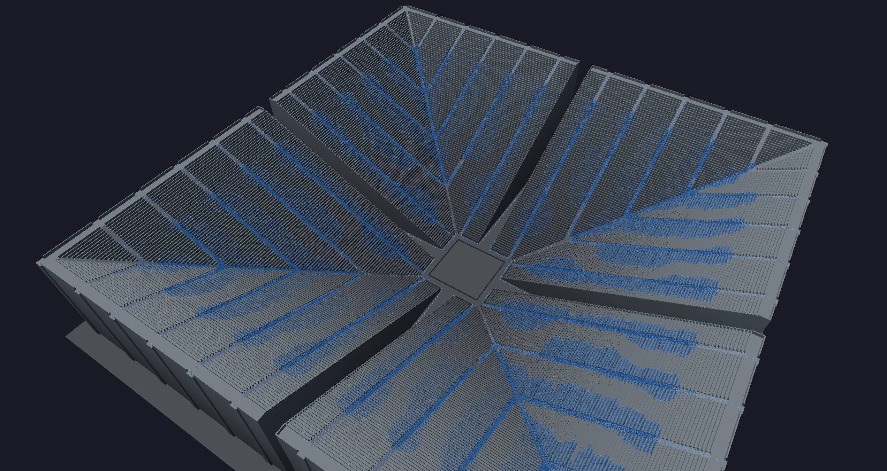
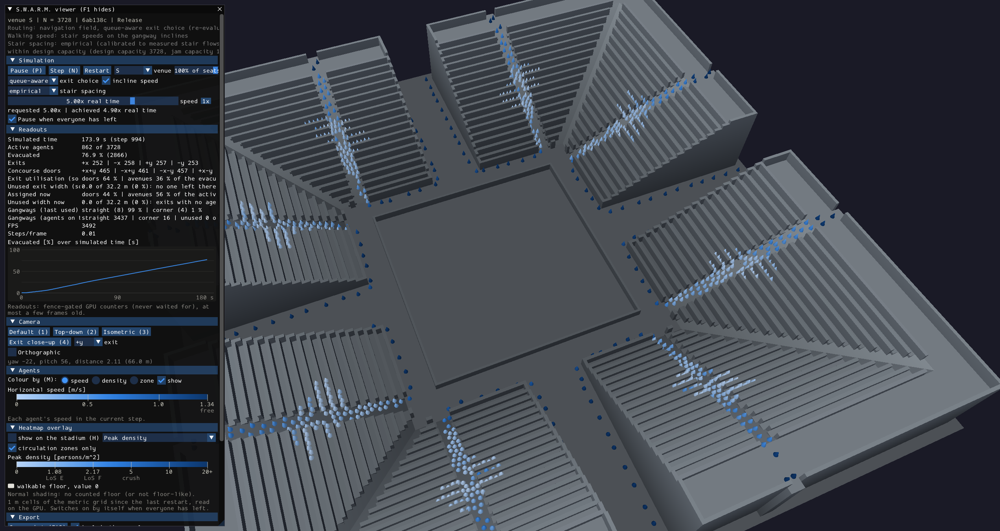
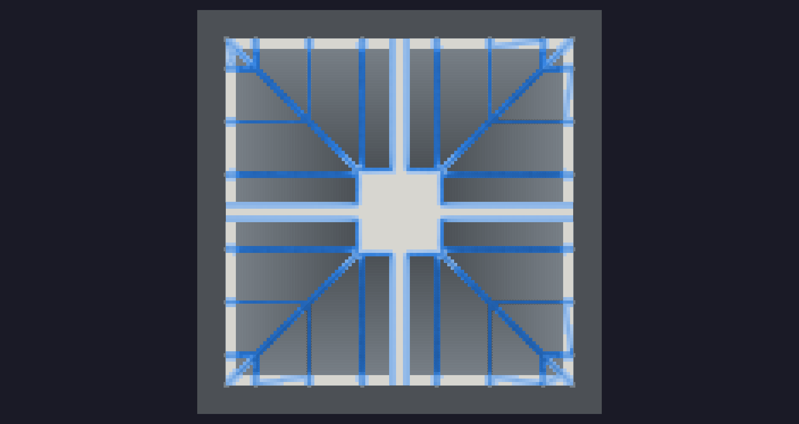

# SWARM: GPU crowd evacuation simulation

SWARM simulates the evacuation of a stadium on the GPU, in real time, with OpenGL 4.3 compute shaders. Every person is a hard body that follows a navigation field, keeps its distance, queues, chooses an exit and slows down on stairs. A 3D viewer shows the run and paints the safety metrics onto the floors.

It comes with four venues, from a 4 096-person reference terrace to a generated seated bowl of 63 424 seats, a CPU reference that checks the GPU's results, and the data behind every number in [results/RESULTS.md](results/RESULTS.md).

- How the model works: [docs/MODEL.md](docs/MODEL.md)
- The viewer in full: [docs/VIEWER.md](docs/VIEWER.md)
- The thesis: Bachelor's thesis, UJEP 2026/27; the link will be added after submission.



*Venue L, 63 424 agents, 297 s into the evacuation. Agents are coloured by density.*



*The control panel beside venue S: 3 728 agents, 174 s in, 76.9% evacuated. Agents are coloured by speed.*



*Top-down peak-density heatmap of venue M after its full evacuation (15 832 agents, 563.4 s). The seat rows are left out; the dark lines are the gangways.*

## Requirements

Windows 10/11, 64-bit, and a GPU with OpenGL 4.3.

SWARM also needs Microsoft's OpenMP runtime, `VCOMP140.dll`, which is not in the zip. If Windows reports that it is missing, install the Microsoft Visual C++ Redistributable (x64) from [Microsoft's download page](https://learn.microsoft.com/en-us/cpp/windows/latest-supported-vc-redist).

| GPU | Status | Venues |
|---|---|---|
| AMD | Tested: Radeon RX 7800 XT, Adrenalin 26.10.1 | terrace, S, M, L |
| NVIDIA | Expected to work, untested | terrace, S, M, L expected |
| Intel, Windows drivers | Measured: UHD Graphics (i5-1035G1), driver 31.0.101.2141, Windows 10 22H2 | terrace only |

At the start SWARM compares the GPU's limits with what each venue needs, and disables a venue the GPU cannot run, with the reason next to it:

| venue | seats | SSBO bindings | largest buffer |
|---|---:|---:|---:|
| terrace | standing, 4 096 by design | 13 | 2 MB at 65 536 agents |
| S | 3 728 | 20 | 99 MB |
| M | 15 832 | 20 | 416 MB |
| L | 63 424 | 20 | 884 MB |

On the Intel GPU above, the check reported 16 SSBO bindings and a 134 MB buffer limit, so S, M and L are disabled. On a pre-release build the terrace ran at 4 096 agents above 16x real time, 16 384 at about 7x and 32 768 at about 1.6x. The v1.0 zip finished the 4 096-agent evacuation at the same step (2720) as the pre-release build. The screenshots and readings are in [results/validation/platforms/intel_uhd/README.md](results/validation/platforms/intel_uhd/README.md).

### Test platforms

| | Desktop | Laptop |
|---|---|---|
| Operating system | Windows 11 Pro 25H2 (build 26200.9711) | Windows 10 Pro 22H2 (build 19045.6466) |
| CPU | Intel Core i5-13600KF (6P+8E cores, 20 threads, 3.5 GHz base) | Intel Core i5-1035G1 (4 cores, 8 threads) |
| Memory | 16 GB DDR4-2133 (2 modules) | 16 GB DDR4-3200 |
| GPU | AMD Radeon RX 7800 XT | Intel UHD Graphics |
| Driver | Adrenalin 26.10.1 | 31.0.101.2141 |
| Venues | terrace, S, M, L | terrace only |

Every result in [results/RESULTS.md](results/RESULTS.md) comes from the desktop.

## Download and run

1. Download `SWARM-v1.0-windows-x64.zip` from the release and extract it into a folder you can write to (about 670 MB unpacked). The navigation tables of venues S and M come with it, in `navcache\` beside `SWARM.exe`.
2. Optional, for venue L: download `SWARM-v1.0-navcache-L.zip` and extract it. In the Extract dialog, set the destination to the folder that holds `SWARM.exe`. It adds L's tables (about 1.2 GB) to `navcache\`; without them, L's first start builds them, which takes about 8 minutes more.
3. Run `SWARM.exe`. It opens the terrace with 4 096 agents. To change venue, pick S, M or L in the panel's venue selector and press Restart.

A venue's first start on a PC takes longer, because the driver compiles its shaders. Times on the desktop above:

| start | terrace | S | M | L |
|---|---:|---:|---:|---:|
| first start, navigation tables present | 5.7 s | 48 s | 2.1 min | 3.6 min |
| first start, tables built on the spot (L without its zip, or a build from source) | 5.7 s | 54 s | 3.3 min | 11.3 min |
| later starts | 1.4 s | 0.6 s | 2.0 s | 4.7 s |

Moving the folder or updating the graphics driver compiles the shaders again. On the desktop the window keeps responding during a load.

`SWARM.exe` is a console program, so Windows also opens a console window. Closing that window ends SWARM. `SWARM --help` lists the command-line options.

## Build from source

You need Visual Studio 2026 with the C++ desktop tools (the only toolchain tested), which include CMake and Ninja. From an x64 Native Tools command prompt, in the repository root:

```bat
cmake -S . -B out/build/x64-Release -G Ninja -DCMAKE_BUILD_TYPE=Release
```

```bat
cmake --build out/build/x64-Release
```

```bat
out\build\x64-Release\SWARM.exe
```

The build copies the shaders and venue files next to the programs. All third-party code is in `external/`.

To check a build, run these. The first run compiles the shaders, so `test_gpu` can take several minutes.

```bat
out\build\x64-Release\test_clock.exe
```

```bat
out\build\x64-Release\test_gpu.exe --quick
```

```bat
out\build\x64-Release\SWARM.exe --selftest-ui
```

GPU results are pinned to one driver (AMD 26.10.1.261008): on another driver the GPU pin checks warn instead of failing.

A headless evacuation with the safety metrics writes its tables under `out/results/`:

```bat
out\build\x64-Release\run_experiment.exe --venue S --load 1 --name demo
```

`tools/package/package_release.py` builds the release zips. The table and figure scripts in `tools/figures` need Python 3 with NumPy and Matplotlib. `tools/experiment/thesis_matrix.sh` (bash) repeats the experiment matrix, and its new runs also go under `out/results/`.

## Controls

| input | action |
|---|---|
| **Esc** | quit |
| **F1** | show or hide the panel |
| **P** | pause or resume |
| **N** | one simulation step, while paused |
| **[** / **]** | halve or double the playback speed (0.1x to 20x real time) |
| **V** | VSync on or off |
| **W A S D** | move the orbit centre on the ground |
| **1 2 3 4** | camera presets: default, top-down, isometric, exit close-up |
| **M** | next agent colouring: speed, density, zone |
| **H** | heatmap overlay on or off |
| **F12** | screenshot |
| **F9** | top-down heatmap export |
| left-drag | rotate the camera |
| right-drag | pan |
| mouse wheel | zoom |

Exports go to a `screenshots` folder beside the program.

## Results

Each venue at full occupancy, with the default model. Evacuation times are in simulated seconds. Step times come from the desktop, with the crowd at the start of the evacuation / congested.

| venue | seats | time to evacuate | conservative stair flow | GPU ms per step | real-time factor | GPU vs 20 CPU threads |
|---|---:|---:|---:|---:|---:|---:|
| S | 3 728 | 238.2 s | 253.6 s | 0.678 / 1.278 | 258x / 137x | 7.4x / 3.2x |
| M | 15 832 | 563.4 s | 591.0 s | 0.974 / 2.363 | 180x / 74x | 20.7x / 6.9x |
| L | 63 424 | 1 477.4 s | 1 588.5 s | 1.861 / 3.928 | 94x / 45x | 49.8x / 17.3x |

- **Evacuation time grows much faster than capacity.** M exceeds the 8-minute planning reference its exits were sized for by 17%, and L is at 3.1x.
- **The gangways, not the exits, set the time.** The doors run at 29-77% of their capacity, so a total exit width rule does not guarantee egress in deep single-tier bowls.
- **Choosing exits by their queues matters.** With everyone going to the nearest exit, the evacuation takes 33-52% longer.
- **The default model is robust at the heaviest loads.** No run gridlocked or stalled (0 of 52). One gridlock occurred in an earlier version of the model, before the stair calibration; its mechanism is not ruled out.

Literature values such as the Green Guide stair flow and the 8-minute reference are as reported in the cited sources and not yet checked against the originals. The full results, methods and known limitations are in [results/RESULTS.md](results/RESULTS.md); [results/README.md](results/README.md) says what each folder holds.

## Licence

MIT: see [LICENSE](LICENSE). Third-party licences are in [THIRD_PARTY_NOTICES.txt](THIRD_PARTY_NOTICES.txt).
